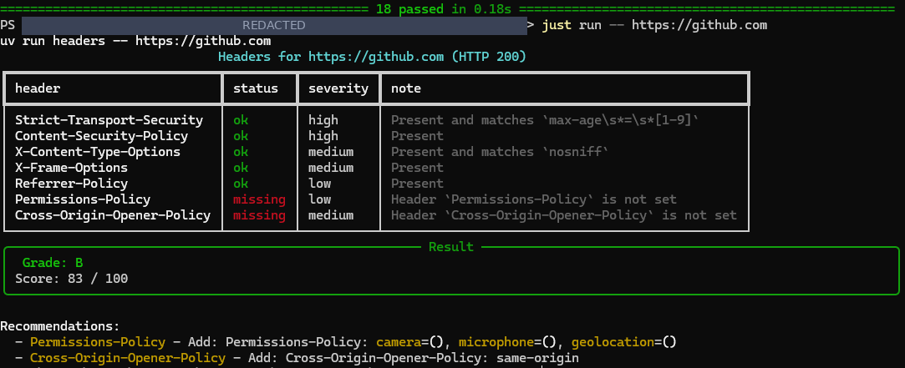
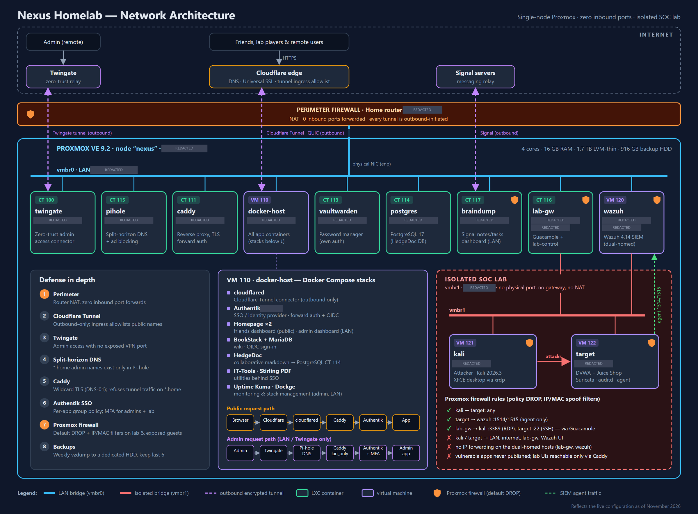
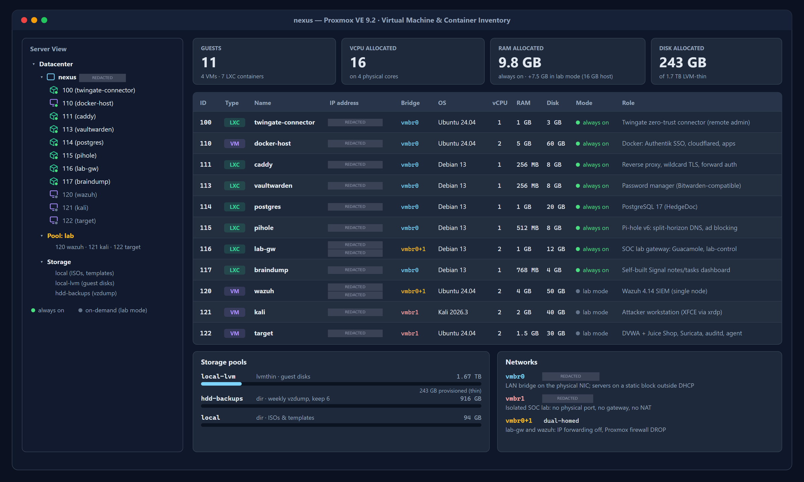
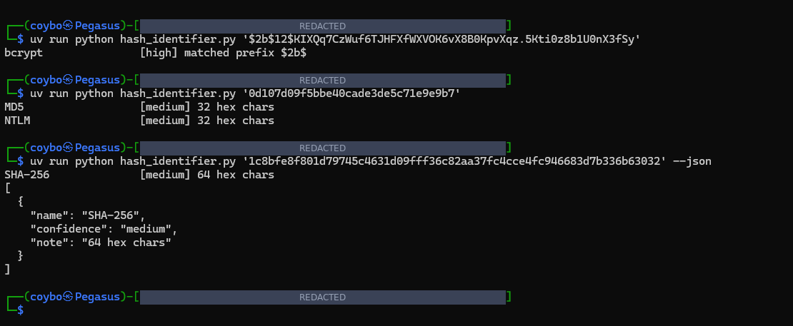
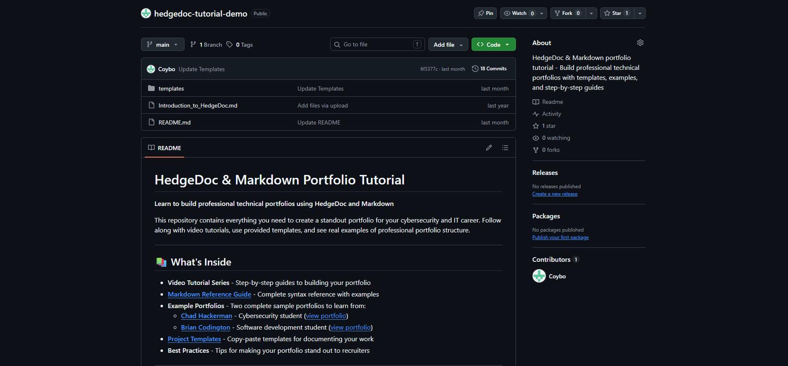
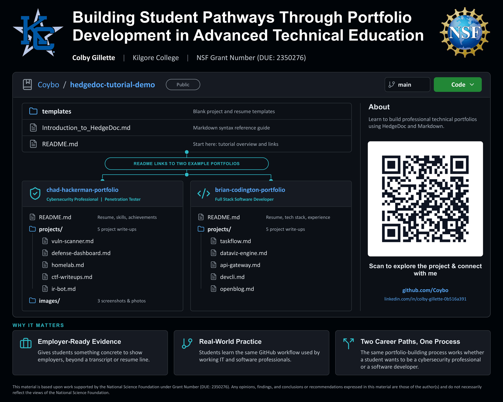

<div align="center">

# `> Colby Gillette`

### Cybersecurity & Networking Student | Red Team Aspirant | Technical Problem Solver

**Kilgore College** · A.A.S. Cybersecurity & Networking · **GPA 4.0** · Expected graduation 2026 · Longview, TX


[](https://www.linkedin.com/in/colby-gillette-0b516a391/)
[](https://github.com/Coybo)

[whoami](#whoami) · [skills](#ls-skills) · [projects](#cd-projects) · [conference](#cat-conferencetxt) · [experience](#cat-experiencetxt) · [roadmap](#cat-roadmaptxt) · [contact](#contactsh)

</div>

---

## `whoami`

```console
user@portfolio:~$ whoami
Colby Gillette

user@portfolio:~$ cat about.txt
```

I'm a cybersecurity student making a career change from **automotive diagnostics** and **armed security** into **red team and risk analysis operations**. Fixing cars for seven years taught me to isolate a fault methodically. Working security taught me risk assessment, incident documentation, and staying calm under pressure. Cybersecurity is the same mindset applied to a new kind of problem: *finding and fixing weaknesses before someone else exploits them.*

I build security tools in Python, practice in my own homelab, compete in CTFs, and write the tutorials I wish I'd had. This repo is where that work lives.

```console
user@portfolio:~$ cat seeking.txt
NOW      : IT Support Technician  |  Junior SOC Analyst
2 YEARS  : Junior Penetration Tester  |  Red Team Associate
```

---

## `ls skills/`

| Area | What I work with |
|------|------------------|
| **Security** | Network security fundamentals · vulnerability assessment · penetration testing (lab) · HTTP security headers · password hash formats |
| **Systems & Networking** | Linux administration · Linux command line · virtualization · network segmentation · firewall rules |
| **Programming & Scripting** | `Python` · `Bash` · `Markdown` · async Python · CLI design |
| **Dev Tooling** | `Git` / `GitHub` · `pytest` · `respx` · `ruff` · `uv` · `just` |
| **Documentation & Teaching** | Technical writing · tutorial design · `HedgeDoc` · presentations · Microsoft Office Suite |
| **Professional** | Diagnostic troubleshooting · risk assessment · security protocols · incident documentation · emergency response |

---

## `cd projects/`

> **Featured:** 🔐 [HTTP Headers Scanner](#01--http-headers-scanner) · 🧪 [Cybersecurity Homelab](#02--cybersecurity-homelab) · 🔑 [Hash Identifier](#03--hash-identifier) · 📚 [Portfolio Tutorial & Curriculum Content](#04--hedgedoc--markdown-portfolio-tutorial)

---

### 01 // HTTP Headers Scanner

```text
STATUS : Completed
STACK  : Python 3.10+ · async scanning · pytest · respx · ruff · uv
REPO   : https://github.com/Coybo/http-headers-scanner
```

A command-line tool that scans a URL for **seven security headers** (HSTS, CSP, X-Content-Type-Options, X-Frame-Options, Referrer-Policy, Permissions-Policy, Cross-Origin-Opener-Policy) and grades the site **A to F**, with recommendations for anything missing or weak.

<div align="center">

<a href="images/http-headers-scanner.png"></a>

*Example scan output: per-header results, overall grade, and recommendations.*

</div>

**Why I built it:** CTFs teach me how attacks work. I wanted to understand the defensive side too: what a well-configured site does to protect its users, and how to check it automatically.

**What I built on top of a guided project:**
- Added a seventh rule for **Cross-Origin-Opener-Policy**
- Added `--json` output for `jq`, CI, and dashboards
- Added `--min-grade` with exit codes (`0` pass · `1` below threshold · `2` request failed) so CI can fail a build
- Added **async multi-URL scanning** with a concurrency limit and per-URL error handling
- Wrote fast, offline tests by **mocking network calls** with `respx`

```console
user@portfolio:~$ headers https://example.com --min-grade B
user@portfolio:~$ headers https://example.com --json | jq '.score'
```

**What I learned:** What each header actually defends against (SSL-stripping, XSS, clickjacking, MIME-sniffing, cross-origin attacks), what makes a value strong or weak, and how to turn that into a score people can act on.

*Credit: based on a guided project from [CarterPerez-dev/Cybersecurity-Projects](https://github.com/CarterPerez-dev/Cybersecurity-Projects), then extended as described above.*
*Responsible use: only scan sites you own or have permission to test.*

[**View repo →**](https://github.com/Coybo/http-headers-scanner)

---

### 02 // Cybersecurity Homelab

```text
STATUS : Ongoing
STACK  : Virtualization · Linux · network segmentation · firewall rules · security tools
TYPE   : Personal security testing environment
```

A safe, personal environment where I practice real-world security and networking skills outside of class. I configured virtual machines, segmented the network, wrote firewall rules, and ran **penetration testing exercises against my own lab systems**.

<div align="center">

<a href="images/homelab-diagram.png"></a>

*Lab network layout: virtual machines, segments, and firewall.*

<a href="images/homelab-vms.png"></a>

*Virtual machines running in the lab.*

</div>

**What I practiced:**
- **Virtual machine setup and management:** run a `Proxmox VE` homelab of **11 VMs and LXC containers** (Docker host, Wazuh SIEM, Kali, a vulnerable target, Pi-hole, Caddy, Vaultwarden)
  - Organized with resource pools and weekly `vzdump` backups to a separate disk
  - Used **snapshot and rollback**: the lab target resets to a clean snapshot after each round
- **Network segmentation and firewall configuration:** built an **isolated attack network** on its own Proxmox bridge (`vmbr1`) with no uplink, gateway, or NAT
  - Per-VM Proxmox firewall rules limit Kali to the target only, and the target can reach only the Wazuh agent ports
  - **Proved the isolation with 11 of 11 tests**, including trying to route through the machines connected to both networks
  - Nothing is port-forwarded on the router: outside access goes through `Cloudflare Tunnel` and `Authentik` SSO with MFA, and admin access goes through `Twingate`
- **Penetration testing against my own systems:** used `Kali Linux` (`Nmap`, `Nikto`, `Burp Suite`, SQL injection, `Hydra`) against `DVWA` and `OWASP Juice Shop`, and watched for detection in `Wazuh` with `Suricata` IDS and `auditd`
- **Full red team / blue team exercise:**
```text
RED TEAM  : Nmap + Nikto scan of the target → SQL injection from Kali
BLUE TEAM : confirm the matching Wazuh + Suricata alerts → investigate on the target's shell
RESET     : restore the target to a clean snapshot
```
 
  I also wrote a **shared playbook with an incident write-up template**.

**Outcome:** A working lab that gives me continued hands-on practice with the same tools and techniques used in cybersecurity roles.

---

### 03 // Hash Identifier

```text
STATUS : Completed
STACK  : Python · pytest · uv · just
REPO   : https://github.com/Coybo/hash-identifier
```

A CLI that guesses which algorithm produced a password hash using two rule types:
- **Prefix rules** *(high confidence)*: `$2b$` bcrypt · `$6$` sha512crypt · `$1$` md5crypt · `{SSHA}` salted SHA-1
- **Hex-length rules** *(medium confidence)*: 32 / 40 / 56 / 64 / 128 characters narrow it to MD5 or NTLM, SHA-1, SHA-224, SHA-256, or SHA-512

<div align="center">

<a href="images/hash-identifier.png"></a>

*High-confidence prefix match (bcrypt), an ambiguous length match (MD5 or NTLM), and `--json` output (SHA-256).*

</div>

**What I did:** Wrote the detection logic with confidence levels, supported argument and piped input plus `--json` output, and added a full `pytest` suite, `ruff` linting, a `justfile`, and a one-command `install.sh`.

**What I learned:** Hash formats, and the limits of heuristics. MD5 and NTLM share an output length, so I documented that ambiguity honestly instead of hiding it. I also built this to grow a toolkit I can use in CTFs.

[**View repo →**](https://github.com/Coybo/hash-identifier)

---

### 04 // HedgeDoc & Markdown Portfolio Tutorial

```text
STATUS : Published, video series in progress
STACK  : Markdown · HedgeDoc · GitHub
REPO   : https://github.com/Coybo/hedgedoc-tutorial-demo
```

A tutorial for Kilgore College CIT students on building professional technical portfolios. It includes a Markdown syntax reference, blank project and résumé templates, and **two complete example portfolios** (a cybersecurity professional and a full-stack developer) that students can copy.

Created as part of my **Portfolio Developer work-study role**, working with faculty to keep the content aligned with course objectives. This work was also presented at a national conference (see below).

<div align="center">

<a href="images/tutorial-repo.png"></a>

*The tutorial repository: templates, a Markdown reference, and two example portfolios.*

</div>

**What I learned:** How to teach technical material clearly and structure documentation so someone can follow it without me in the room.

[**View repo →**](https://github.com/Coybo/hedgedoc-tutorial-demo)

---

## `cat conference.txt`

### 🏛️ ATE PI Conference · Washington, DC · October 2026

I represented **Kilgore College as a student in STEM** at the National Science Foundation's Advanced Technological Education (ATE) Principal Investigators Conference, where I presented a poster:

***Building Student Pathways Through Portfolio Development in Advanced Technical Education***

The poster covers how the portfolio tutorial gives students **employer-ready evidence** beyond a transcript, teaches the **same GitHub workflow used by working IT and software professionals**, and shows how **one process serves two career paths** (cybersecurity and software development).

<div align="center">

<a href="images/ate-pi-poster.png"></a>

*My poster at the ATE PI Conference.*

</div>

<!-- OPTIONAL: uncomment once you add a photo of yourself presenting.
<div align="center">


</div>
-->

<sub>*This material is based upon work supported by the National Science Foundation under Grant Number (DUE: 2350276). Any opinions, findings, and conclusions or recommendations expressed in this material are those of the author(s) and do not necessarily reflect the views of the National Science Foundation.*</sub>

---

## `cat experience.txt`

| Role | Organization | Dates |
|------|--------------|-------|
| **Portfolio Developer** *(Work-Study)* | Kilgore College, CIT Program · Kilgore, TX | Nov 2025 to Present |
| **Armed Security Officer** | Texas Metro Patrol · Longview, TX | May 2025 to Present |
| **Automotive Service Technician** | Automotive service | 2018 to 2025 |

**Portfolio Developer:** create tutorial and presentation content for cybersecurity and IT students; collaborate with faculty to align content with curriculum objectives.

**Armed Security Officer:** risk assessment, security protocols, incident documentation, and emergency response.

**Automotive Service Technician:** diagnostic troubleshooting, technical documentation, and precision mechanical repair. *This is where my systematic approach to finding root causes comes from.*

---

## `cat education.txt`

**Kilgore College** · Associate of Applied Science, Cybersecurity & Networking
*August 2024 to Present · Expected graduation 2026 · GPA 4.0*
**Focus:** Network Security · Penetration Testing · Linux Systems Administration · Python Programming

## `cat certifications.txt`

| Certification | Focus | Status |
|---------------|-------|--------|
| **CompTIA Network+** | Networking fundamentals and infrastructure | 🟡 In progress |
| **CompTIA Security+** | Security concepts and best practices | 🟡 In progress |
| **CompTIA Linux+** | Linux administration, command line, security fundamentals | 🟡 In progress |

## `cat roadmap.txt`

What I'm working on next:

- [ ] Earn CompTIA Network+, Security+, and Linux+
- [ ] Build deeper hands-on experience with red team methodologies and penetration testing tools
- [ ] Grow my Python automation skills for security and network tasks
- [ ] Learn formal incident response and risk analysis frameworks used in SOC environments

---

## `./contact.sh`

I'm looking for an **entry-level IT or security role** where I can keep building toward red team work. If you'd like to talk, the best way to reach me is on LinkedIn:

[](https://www.linkedin.com/in/colby-gillette-0b516a391/)
[](https://github.com/Coybo)

<div align="center">

`$ exit`

</div>